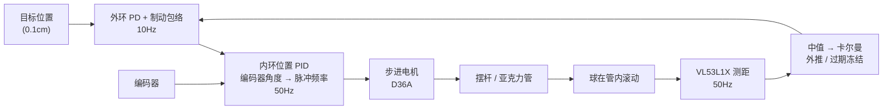

# Hilab_PID — 车载平衡滚球运动控制系统

用一根可倾斜的亚克力管、一个单点激光测距模块、一台带编码器的步进电机，把 φ30mm 的 POM 球稳定在管内任意位置，并做定点、折返与正弦跟踪。主控是 STM32F103C8T6，控制结构为「球位置 → 摆杆角度 → 脉冲频率」的串级双环。项目背景是 2026 年电赛 H 题「车载平衡滚球运动控制系统」。

这个仓库面向公开分享：重点不是比赛成绩，而是**可迁移的设计思路、公式和踩坑经验**。具体增益参数与本机机械强绑定，写在代码里而不写进文档——换一根管子、换一个球，它们就失效了。

## 它做什么

- **定点**：目标位置由串口下发（单位 0.1cm），球移动到目标后保持；进入目标附近 5mm 的死区后不再输出新的修正量，用于抑制追噪声。
- **折返**：上位机按序下发 0 → 一端 → 另一端 → 0，系统逐段闭环到位。
- **正弦跟踪**：上位机每 50ms 下发一次目标，球跟随 ±8cm / 4s 的正弦轨迹（**指标未达标**，见下）。
- **在线整定**：一行逗号分隔的 14 个整数经串口下发，实时改外环/内环/前馈/限幅，不用重新烧录。
- **遥测**：USART1 以 50Hz 输出 11 通道 VOFA FireWater 帧，可直接用 VOFA+ 观察。
- **按键启停**：PA0 单击切换运行/停止；停止时电机脉冲频率置 0，内环仍在后台运算。

## 硬件方案

| 部件 | 选型 | 说明 |
|---|---|---|
| 主控 | STM32F103C8T6 | Cortex-M3，72MHz，64KB Flash / 20KB RAM |
| 测距 | VL53L1X | I2C1（PB6/PB7）；8×8 ROI、SHORT 模式、16ms 测量预算、20ms 帧周期 |
| 显示 | SSD1306 OLED 128×64 | I2C2（PB10/PB11），地址 0x3C |
| 执行器 | MS42CG 步进电机 + D36A 驱动 | 16 细分 → 3200 脉冲/圈；EN=PA1，DIR=PA2，STEP=PA3/TIM2_CH4 |
| 位置反馈 | 电机同轴增量编码器 | 1000 线 × 4 倍频 = 4000 计数/圈（PA6/PA7，TIM3） |
| 机械 | 亚克力管 + 法兰联轴器 | 管外径 40mm、长 500mm；电机轴与摆杆 1:1 直连；小摆杆 + 垫高，枢轴约 110mm |
| 滚动体 | 白色 POM 球 φ30mm | 漫反射球面，替换掉回波很差的钢珠 |
| 上位机 | USART1 115200 8N1 | 参数下行 + VOFA 遥测上行 |
| 安全 | IWDG | 超时约 1.64s，主循环心跳喂狗 |

> 传动换算：1 个 STEP 脉冲 ≈ 1.25 个编码器计数。这个比例是角度环增益和限幅的单位基础。

## 控制架构



外环慢（10Hz），因为它只看球的位置；内环快（50Hz），负责把电机、传动回差、静摩擦这些非线性收进快速环里。两级之间传递的量是**摆杆角度指令**（编码器计数）。

## 关键取舍

- **单点 ToF 而不是对射阵列**：成本低、不用在管壁开孔，但测的是球面最近点，回波随距离、材质、角度变化，量程必须实测标定。
- **POM 球而不是钢珠**：钢珠的曲面镜面反射回波弱、噪声大；白色 POM 是漫反射，信噪比明显更好，但球面仍会让"最近点"游移。
- **亚克力直管而不是 PPR 半圆管**：透明管可直接穿透测距，直管内滚动一致性也更好。
- **步进 + 同轴编码器**：不需要减速箱就能定位，编码器提供角度闭环；代价是失步风险和换向时序约束。
- **遥测优先**：所有整定都靠串口数据闭环，不靠"看着差不多"。

## 已验证与已知边界

| 项目 | 现状 |
|---|---|
| 定点保持 | 中段残差通常落在 5mm 死区内；两端受静摩擦限制，可能停在死区边缘 |
| 稳态抖动 | 位置 σ 约 1~3mm；残余抖动大部分落在 ±30 counts 传动回差内，摆杆实际没有明显运动 |
| 正弦跟踪 | **未达 15mm 动态误差**。参数扫描最好约 50mm RMS，且输出长期饱和——瓶颈是执行器/传动可提供的加速度上限，不是增益 |
| ToF 量程 | 回波率阈值放宽后理论边界约 465mm；实测 400~479mm 有效帧 100%；更远处出现弱回波告警 |
| 测距盲区 | 球距传感器 0~2cm 不作为有效工作点 |
| 数据失效 | 连续 200ms 无有效帧时滤波冻结、外环停止积分，避免按最后速度无限外推把电机顶到限位 |

## 文档

| 想了解 | 看 |
|---|---|
| 系统组成、硬件取舍、模块职责、时序 | [docs/architecture.md](docs/architecture.md) |
| 单点 ToF 的坑、滤波链、公式、数据有效性 | [docs/sensing.md](docs/sensing.md) |
| 串级双环、制动包络、静摩擦、调参方法论 | [docs/control.md](docs/control.md) |

## 快速开始

环境要求：

- `arm-none-eabi-gcc` 交叉工具链、CMake、Ninja、openocd
- 串口驱动；VOFA+ 可选，用于观察波形
- 仓库内 `.vscode` 配置按 `C:/msys64/ucrt64` 编写，其他环境需自行修改 `settings.json` 与 `launch.json` 中的工具路径

```powershell
cmake --preset Debug
cmake --build --preset Debug
openocd -f openocd_stlink.cfg -c "program build/Debug/Hilab_PID.elf verify reset exit"
```

- 烧录配置还有 `openocd_jlink.cfg`、`openocd_dap.cfg` 可选。
- 串口参数行格式与通道定义见 [docs/architecture.md](docs/architecture.md)。
- `tools/tof_acquire.py`、`tools/tof_eval.py` 是 8 通道旧固件时期的实验脚本，与当前 11 通道协议不兼容，仅用于分析 `tools/data/` 下的历史数据；当前固件的采集请按 [docs/architecture.md](docs/architecture.md) 的协议自行实现。

## 工程实现要点

- **遥测发送绕开 HAL**：`HAL_UART_Transmit` 会持有 UART 锁，ISR 里发送期间 RX 回调重挂会失败，最终导致接收永久停摆。本项目用寄存器级阻塞直发，并在错误回调与主循环各做一层重挂。
- **阻塞操作只在主循环**：ToF 读取最长可等 2s，绝不放进定时器中断；OLED 刷新、串口解析同理。
- **喂狗靠心跳**：主循环每圈置位心跳，1ms 中断确认心跳后才喂狗，主循环卡死会自然触发复位。
- **CubeMX 与手写文件分离**：手写模块只加在根 `CMakeLists.txt`，不改 CubeMX 生成的构建文件。
- **通道表以文档为准**：通道顺序同时出现在固件 `vofa[]` 与上位机脚本中，改动时先改文档里的表，再同步两处，禁止只改一边。

## 使用与安全

- 本项目采用 [MIT 许可证](LICENSE)。
- 所用激光模块功率低于 5mW，调试时避免直射人眼。
- 步进电机上电即使不转也会锁定绕组，拆装机械前先断电。
